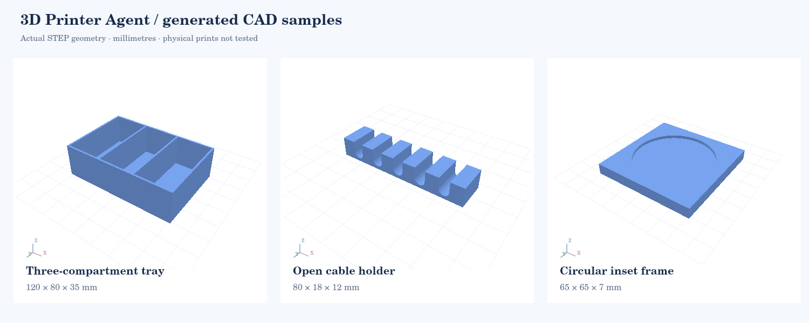

# 3D Printer Agent

[](https://github.com/uulab-official/3d-printer-agent/actions/workflows/ci.yml)
[](https://github.com/uulab-official/3d-printer-agent/actions/workflows/native-bambu.yml)
[](LICENSE)

**An open-source local workspace for parameterized CAD, filament profile review, and Bambu Studio preparation.**

한국어 요청으로 치수가 있는 모델을 만들고, 필라멘트 설정의 근거를 확인하며, Bambu Studio 슬라이싱을 준비하는 **로컬 작업 공간 v0.4**입니다. [uulab-official/3d-printer-agent](https://github.com/uulab-official/3d-printer-agent)에서 개발합니다. API 키 없이 로컬 CAD 생성과 설정 검토를 사용할 수 있습니다.

이 버전은 `수납함`, `열린 케이블 받침`, `원형 인셋 프레임` 세 가지 파라메트릭 모델을 실제 CAD로 생성합니다. 일반적인 자유형 모델링, MakerWorld 검색·리믹스, 실시간 쇼핑 수집, 프린터 직접 제어는 후속 개발 범위입니다. [현재 개발 상태](docs/STATUS.md), [로컬 검증 기록](docs/VERIFICATION.md), [기여 안내](CONTRIBUTING.md)를 함께 확인하세요.

**Studio 프로젝트 하나로 출력 설정을 가져올 수 있습니다.** 기록된 프린터·노즐·재료·플레이트를 확인하고, 현재 생성한 CAD에 적용한 3MF를 준비합니다. Studio가 없어도 준비 파일을 내려받을 수 있으며 실제 슬라이싱은 별도 실행합니다. 지원 버전과 범위는 [Studio 프로젝트 설정 가져오기](docs/STUDIO_PROJECTS.md)를 확인하세요.



위 이미지는 생성한 STEP 형상과 앱의 Canvas 렌더 코드를 사용한 결과입니다. 실제 브라우저 화면이나 실물 출력 사진은 아닙니다.

## 시작하기

권장 실행 경로는 **Python 3.12 가상환경**입니다. Linux·macOS·Windows의 설치 패키지 검증과 native Bambu 실행 검증은 분리합니다. 플랫폼별로 실제 통과한 커밋과 범위는 [검증 기록](docs/VERIFICATION.md)을 확인하세요. 이 앱은 자신의 PC에서 사용하는 단일 사용자 앱이며 공개 서버로 배포하는 구성은 제공하지 않습니다.

패키지 설치는 [검증된 v0.3.0 릴리스](https://github.com/uulab-official/3d-printer-agent/releases/tag/v0.3.0)와 [설치·릴리스 안내](docs/RELEASES.md)를 확인하세요. 같은 wheel의 Ubuntu·macOS·Windows 설치, CAD·HTTP·백업·복원 검사는 운영체제마다 133개를 통과했습니다. Ubuntu 24.04에서는 CAD 의존성을 불러오기 전에 시스템 패키지 `libgl1`이 필요합니다. 준비 명령과 운영 절차는 [로컬 운영 안내](docs/LOCAL_OPERATION.md)에 있습니다.

저장소를 받은 다음 프로젝트 폴더로 이동합니다.

```bash
git clone https://github.com/uulab-official/3d-printer-agent.git
cd 3d-printer-agent
```

macOS / Linux:

```bash
python3.12 -m venv .venv
source .venv/bin/activate
python -m pip install -r requirements.txt
python -m print_agent
```

Windows PowerShell에서는 가상환경 활성화 대신 다음처럼 실행할 수도 있습니다.

```powershell
py -3.12 -m venv .venv
.\.venv\Scripts\python.exe -m pip install -r requirements.txt
.\.venv\Scripts\python.exe -m print_agent
```

브라우저에서 `http://127.0.0.1:8765`를 엽니다. 서버는 자신의 PC에서만 접속할 수 있는 주소에 바인딩합니다. 종료는 `Ctrl+C`입니다. CadQuery를 처음 설치할 때는 CAD 엔진 의존성을 다운로드하므로 시간이 걸릴 수 있습니다.

```bash
python -m print_agent doctor
python -m print_agent --port 8766 --data-dir ./my-print-data
python -m unittest discover -v
```

화면 위의 **로컬 연결과 저장 위치**에서 실제 데이터 폴더를 확인할 수 있습니다.
서버를 재시작했다면 **다시 연결**을 누르세요. 현재 입력을 유지하고 연결만 갱신하며,
실행 결과를 모르는 모델 생성·슬라이싱·저장 요청을 자동으로 반복하지 않습니다.
같은 데이터 폴더는 한 서버만 사용할 수 있습니다. 중단된 생성은 작업 기록에서
확인하고 **저장된 치수로 다시 준비**할 수 있습니다.

새 설치는 운영체제의 사용자 데이터 폴더에 저장합니다. 명시한 `--data-dir`,
`PPA_DATA_DIR`, 기존 작업이 있는 `./data`는 우선 적용하며 기존 데이터를 자동으로
옮기지 않습니다. `doctor`는 선택한 경로와 필수 구성 요소를 검사하고, 필수 검사에
실패하면 종료 코드 1을 반환합니다. 설치·업데이트·백업·복구 절차는
[로컬 운영 안내](docs/LOCAL_OPERATION.md)에 있습니다.

UI 상태 회귀 검사는 개발용 Node.js가 있을 때 `node tests/test_ui_state.cjs`로 실행할 수 있습니다. DOM 대역을 사용하는 검사이며 실제 브라우저 테스트와 구분합니다.

CI는 Python 검사와 패키지 설치, UI 상태 검사, 실제 Chromium에서의 브라우저 검사를 실행하도록 구성했습니다. 실행 결과는 [GitHub Actions](https://github.com/uulab-official/3d-printer-agent/actions)에서 커밋별로 확인합니다. 브라우저 검사에는 개발용 Node.js가 필요하며 실행 방법은 [기여 안내](CONTRIBUTING.md)를 따릅니다.

위는 개발 소스에서 실행하는 방법이며 `pip install .` 후 `printer-agent` 진입점도 제공합니다. 별도의 [패키지 검증 workflow](.github/workflows/package-qualification.yml)는 같은 wheel 바이트를 세 운영체제에 설치하고 소스 폴더 밖에서 실제 CAD·API·저장·재시작·백업·복원을 검사합니다. [릴리스 workflow](.github/workflows/release.yml)는 같은 현재 main 커밋의 앱·설치·native 검증이 모두 통과한 뒤 그 wheel을 재빌드 없이 게시합니다. 실제 게시 결과는 [Releases](https://github.com/uulab-official/3d-printer-agent/releases), 개별 검사는 [GitHub Actions](https://github.com/uulab-official/3d-printer-agent/actions)에서 확인하세요.

### 업데이트 전 전체 작업 백업

브라우저의 편집 내용을 저장하고 서버를 종료한 뒤 실행합니다. 실제 데이터 경로와 새 출력 파일·복원 폴더 경로로 바꾸세요. 출력 파일과 복원 폴더의 상위 폴더는 미리 준비합니다.

```bash
printer-agent backup --data-dir "/내/데이터" --output "/내/백업/workspace.ppa-backup.zip"
printer-agent backup-info --archive "/내/백업/workspace.ppa-backup.zip"
printer-agent restore --archive "/내/백업/workspace.ppa-backup.zip" --destination "/내/복원된-데이터"
printer-agent --data-dir "/내/복원된-데이터"
```

CAD 기록과 원본·부분 파일, 저장한 필라멘트 원본·미완성 초안을 함께 보관합니다. 실행 중인 데이터의 백업과 기존 폴더를 덮어쓰는 복원은 거절합니다. 모델별 ZIP 내보내기는 전체 작업 백업이 아니며, 브라우저에서 아직 저장하지 않은 입력은 포함되지 않습니다. 한도와 확인 방법은 [백업·복원 안내](docs/BACKUP_RESTORE.md)를 참고하세요.

## 사용할 수 있는 작업

| 기능 | 현재 동작 | 확인 범위 |
|---|---|---|
| 처음 만들 물건 | 용도·놓을 공간으로 고르는 원본 시작안 6개, 측정 안내와 치수 편집 | 기존 3종 CAD 기반. 외곽 크기 비교이며 프린터 호환·실물 맞춤은 미검증 |
| 한국어 요청 | mm/cm, 가로·세로·높이, 칸 수 등을 해석 | 규칙 기반 템플릿 모드. 자유로운 대화 이해를 보장하지 않음 |
| 모델 만들기 | CadQuery의 실제 솔리드와 미리보기 메시 생성 | 유효 형상, 연결된 솔리드 하나, 체적, 요청 치수, 닫힌 미리보기 메시 |
| 내보내기 | STL·STEP·3MF·재생산용 Python·SHA-256 manifest | 실제 파일 생성 및 STEP 재읽기 검사 |
| 재료 설정 | Studio 내보내기·여러 JSON 가져오기, 상속 검토, 주요 수치·적용 범위·출처 편집, 원본·초안·사용 조건 저장 및 다시 열기 | 가져온 명시값과 입력한 근거를 검토. 변경 전후를 구분하며 Studio 전체 구성·제조사 인증은 미구현 |
| 교정 변경 검토 | K, flow ratio, MVS 기록의 재검토 필요성 판정 | API 제공. 측정이나 프린터 저장은 하지 않음 |
| Bambu Studio | 명시적 CLI 확인, 설정 파일 묶음 도우미, 플레이트 지정, CLI 실행과 결과 검토 | 버전별 native 검증은 [연동 안내](docs/BAMBU_STUDIO.md)와 검증 기록 참조. 실물 출력은 미검증 |
| 구매 비교 | 직접 입력한 가격·중량·배송비로 kg당 단가 계산 | 실시간 가격·재고·쿠폰은 수집하지 않음 |
| 작업 기록 | 생성 요청·파일·이벤트·사용자 출력 결과, 이전 기록 더 보기, 중단 작업 다시 준비 | 다운로드 바이트 검증과 시작 시 이력 복구. 사용자 결과는 `user_reported`로 구분 |
| 전체 백업·복원 | 저장한 CAD·필라멘트 작업 전체를 검증한 ZIP으로 보관하고 새 폴더에 복원 | 서버 종료 후 CLI 실행. 바이트 무결성과 자료의 정상 여부를 구분 |
| LLM 연결 | OpenAI-compatible Chat Completions 어댑터 | 합성 서버 응답으로 계약 검증. 실제 모델 연결은 미검증 |

### 무엇을 만들지 고르기

**만들거리 찾기**에서 책상·서랍 정리, 케이블 정리, 사진·장식 중 용도를 고르세요.
놓을 공간의 가로·세로·높이는 아는 값만 입력하고 **조건으로 찾기**를 누르면 됩니다.
작은 트레이, 세 칸 정리함, 두 칸 서랍 트레이, 세 줄·다섯 줄 케이블 받침,
원형 인셋 프레임까지 6개의 시작안을 제공합니다. API 키나 모델 서버 없이 동작합니다.

카드의 측정 안내를 살펴본 뒤 **이 시작점으로 치수 준비**를 누르면 기존 치수 편집기로
이어집니다. 입력 중인 치수나 생성한 결과가 있으면 교체 여부를 화면에서 선택할 수
있습니다. 추천을 둘러보거나 조건을 바꾸는 동안 기존 제작안과 다운로드는 유지됩니다.

생성 기록에는 선택한 원본 시작안과 실제 수정한 치수가 따로 남습니다. 공간 비교는
시작안의 외곽 크기에만 적용되며, 치수를 바꾸면 다시 확인해야 합니다. 프린터 베드,
출력 여유 공간, 내부 수납 크기나 실물 끼워맞춤을 검증한 결과는 아닙니다.
[만들거리 찾기 안내와 API](docs/PROJECT_DISCOVERY.md)에 지원 범위와 출처 기록을 정리했습니다.

### 첫 요청 예시

```text
가로 12cm 세로 8cm 높이 3.5cm 수납함을 3칸으로 만들어줘
14cm x 9cm x 4cm 수납함
가로 80mm 세로 18mm 높이 12mm 케이블 받침, 홈 5개
52mm 포토마그넷 프레임 만들어줘
```

제작안에 입력하지 않은 치수의 기본값을 표시합니다. 생성 전 편집할 수 있습니다. `칸 3개`는 칸막이 2개라는 뜻입니다. 원형 인셋의 `fit_clearance=0.3`은 지름 전체에 0.3mm를 더하며, 한쪽당 0.3mm라는 뜻이 아닙니다. 케이블 받침은 위가 열린 홈이며 스냅 고정장치가 아닙니다. 프레임은 원판용 포켓이며 자석·접착·실물 끼워맞춤을 검증하지 않습니다.

모델 3MF에는 형상만 들어 있습니다. 출력 준비가 끝난 G-code 프로젝트가 아닙니다. 인필·서포트·출력 시간·필라멘트 무게는 실제 슬라이싱 후에만 확정할 수 있으며, 이번 버전은 그 통계의 버전별 파서를 구현하지 않아 `null`을 반환합니다.

`examples/`에는 실제 생성한 세 모델과 재생산 소스가 포함됩니다. 앱에서 내려받은 `model.py`는 다음과 같이 새로운 폴더에 같은 형상을 다시 만듭니다.

```bash
python model.py ./reproduced
```

## 필라멘트 설정 검토

숫자를 자동 추정하지 않습니다. 먼저 제품 라벨·정확한 SKU와 현재 프린터 조건을 입력합니다.

`setup`에 필요한 값:

```json
{
  "printer_model": "현재 프린터의 정확한 모델명",
  "printer_preset": "Bambu Studio의 정확한 프린터 프리셋 이름",
  "nozzle_diameter": 0.4,
  "plate_type": "Textured PEI Plate",
  "extruder": "사용 중인 압출기 식별자",
  "feed_mode": "사용 중인 외부 스풀 또는 정확한 AMS 구성 식별자",
  "material_id": "제조사·제품·재료·색상 등을 구분하는 정확한 제품 ID",
  "material_identity_status": "exact"
}
```

위의 0.4와 플레이트는 입력 형식을 보여주는 예시입니다. 사용 중인 장비값으로 바꾸어야 합니다. 단순히 PLA라고만 입력하면 정확한 제품이 확인된 것으로 취급하지 않습니다.

raw Bambu 필라멘트 JSON 또는 다음 envelope를 받습니다.

```json
{
  "id": "프로필 식별자",
  "settings": {},
  "scope": {},
  "source": {
    "authority": "manufacturer",
    "url": "원문 URL",
    "publisher": "발행처",
    "retrieved_at": "확인 시각"
  },
  "validation": {
    "status": "unverified",
    "setup_fingerprint": {}
  }
}
```

빈 `settings`·`scope`는 설명용 구조이며 준비 가능한 설정이 아닙니다. `scope`에는 현재 설정과 대응하는 일곱 장비·재료 조건이 필요합니다. `compatible_printers`의 정확한 프리셋 일치는 `scope.printer_preset` 근거를 대신할 수 있습니다. 다른 모델과 비슷한 이름이라는 이유로 호환 판정을 내리지 않습니다.

준비 가능 판정에는 다음 값이 필요합니다.

- `nozzle_temperature`, `nozzle_temperature_initial_layer`
- `filament_flow_ratio`, `filament_max_volumetric_speed`
- 선택한 플레이트에 대응하는 온도와 첫 레이어 온도
- 해소된 `inherits`·`include`, 명확한 프로필 ID와 적용 범위

현재 플레이트 필드 대응은 Textured PEI, Smooth PEI/High Temp, Engineering, Cool Plate, Bambu Cool Plate SuperTack입니다. 미지원 플레이트나 압출기별 배열 대응이 불분명하면 추가 근거를 요청합니다. 원본 필드를 보존하고, 해석하지 못한 실행 관련 값은 자동 준비를 막습니다.

`ready_to_prepare`는 제한된 설정 검토를 통과했다는 뜻입니다. 공급자 인증·전체 스키마 검증·실물 출력 성공의 증거가 아닙니다. 사용자가 출처를 `manufacturer`라고 입력해도 외부 확인이 완료됐다고 표시하지 않습니다. 같은 장비에서 검증했다는 입력은 `reported_validated`로 표시합니다.

### 여러 프리셋의 상속과 출처 확인

재료 설정 화면에서 관련 JSON 파일을 함께 열고 검토할 대상 프리셋을 선택할 수 있습니다. 부모 파일이 빠졌다면 정확한 이름을 안내합니다. 필요한 파일을 추가한 뒤 다시 검토하세요.

**Studio 내보내기 가져오기**에서는 `.bbsflmt`, `.bbscfg`, 일반 프리셋 `.zip`을 직접 선택할 수 있습니다. 필라멘트 문서를 골라 기존 모음에 추가하고 제외한 프린터·출력 공정 파일을 알려 줍니다. 붙여 넣은 프로필과 기존 미완성 초안을 보존하며, 동일한 원본은 중복 추가하지 않습니다. 묶음·내부 파일의 이름과 원본 바이트 해시는 저장과 검토 보고서에도 남습니다. 지원 형식과 크기 제한은 [Studio 내보내기 안내](docs/FILAMENT_ARCHIVES.md)를 참고하세요.

지원하는 단일 부모 체인은 부모부터 자식 순서로 해석합니다. 화면에서 각 값이 나온 파일과 자식이 덮어쓴 이전 값을 확인하고, 입력 문서·해석 결과·장비 조건을 담은 JSON 검토 보고서를 내려받을 수 있습니다. 대상 JSON을 편집하거나 장비 조건을 바꾸면 이전 결과와 다운로드가 해제됩니다.

`resolved`는 **가져온 파일에 명시된 값의 지원되는 연결을 해석했다**는 뜻입니다. 보고서의 `full_config`와 `native_verified`는 항상 `false`입니다. Studio 내부 기본값을 채우지 않으며, 이 보고서는 Studio로 바로 가져올 전체 프리셋이 아닙니다. `include`, 압출기 variant, `nil` 등의 처리는 아직 지원하지 않으므로 최신 공식 프리셋 중 상당수는 추가 구현이 필요하다고 표시됩니다.

보고서의 문서 `sha256`은 정렬한 JSON 객체를 기준으로 계산하며, 묶음에서 가져온 경우 `origin`에 원본 바이트 해시를 별도로 보존합니다. 지원 범위, API 계약, 원본과 편집본의 구분, 공식 소스 근거는 [필라멘트 프리셋 안내](docs/FILAMENT_PRESETS.md)에 정리했습니다.

### 저장한 작업에서 이어서 편집하기

필라멘트 파일 모음과 원본, 문서별 편집본, 선택한 대상, 프린터·재료 조건을 이름 있는 작업으로 저장하고 다시 열 수 있습니다. 아직 문법이 완성되지 않은 JSON 초안도 그대로 보관합니다. 다른 탭에서 같은 작업을 먼저 저장했다면 충돌을 알려 기존 저장본을 보호합니다.

주요 설정 편집은 노즐 온도·첫 레이어 온도·유량 비율·최대 체적 속도와 선택 플레이트의 베드 온도를 다룹니다. 상속값을 바꿀 때는 선택한 자식에 해당 값만 덮어쓰고 원본과 부모를 보존합니다. 잘못 가져온 문서 하나를 제거하거나 선택한 편집본을 원본으로 복원할 수도 있습니다.

**프로필의 적용 범위와 출처**를 펼치면 해당 파일이 적용되는 프린터·노즐·플레이트·재료 조건과 발행처·원문·확인 시각을 입력할 수 있습니다. 오른쪽의 실제 사용 조건과 별도로 기록하며, 부모나 사용 조건에서 자동으로 채우지 않습니다. 원시 JSON도 필요한 근거를 적용하는 순간 초안에만 envelope를 만들므로 구조를 직접 작성할 필요가 없습니다. 숫자와 근거의 편집은 함께 적용·취소하고, 저장·검토할 때도 먼저 반영합니다.

원본 체인과 비교해 적용 설정이 바뀌면, 상위 프리셋을 수정한 경우까지 기존 검증 주장을 오래된 정보로 표시합니다. 선택한 파일의 적용 범위나 검증 주장 변경에도 재확인을 요구하며, 출처 표기만 정정한 경우는 별도 변경으로 기록합니다. 보고서에서 설정과 근거의 변경 전후를 구분할 수 있습니다. 저장한 작업을 열 때는 입력만 복원하며 검토 결과는 다시 확인합니다. 사용 흐름과 저장·충돌·편집 범위는 [필라멘트 작업 안내](docs/FILAMENT_WORKSPACES.md)를 참고하세요.

## Bambu Studio 연결

Bambu Studio의 공식 CLI 사용 문서는 [Command-Line-Usage](https://github.com/bambulab/BambuStudio/wiki/Command-Line-Usage)입니다. 어댑터는 해당 방식으로 전체 machine/process/filament 구성을 준비합니다. 실제 설치 버전의 `--help`에서 필요한 옵션을 확인한 뒤 실행합니다.

OS의 알려진 설치 경로와 PATH를 탐지합니다. 찾지 못하면 **자신이 설치한 실행 파일**의 절대 경로를 지정하고 앱을 다시 시작합니다.

```bash
export PPA_BAMBU_PATH="/absolute/path/to/bambu-studio"
python -m print_agent
```

```powershell
$env:PPA_BAMBU_PATH = "C:\Program Files\Bambu Studio\bambu-studio.exe"
.\.venv\Scripts\python.exe -m print_agent
```

위 경로는 예시입니다. 앱이 실행 파일을 찾았다는 것과 해당 버전의 CLI가 검증됐다는 것을 구분합니다. Linux AppImage는 시스템 실행에 필요한 환경이 별도로 필요할 수 있습니다. Mac/Windows 경로 발견 코드는 있지만 해당 OS의 native 실행은 아직 시험하지 않았습니다.

화면의 **설치된 슬라이서 확인** 버튼 또는 `python -m print_agent doctor --probe-slicer`로 설치된 프로그램의 `--help`를 명시적으로 실행하고 버전·필수 옵션·진단을 확인할 수 있습니다. 평소 앱을 열거나 일반 `doctor`를 실행할 때는 프로그램을 실행하지 않습니다.

모델을 만든 뒤 full config 패널에서 machine 파일 1개, process 파일 1개, filament 파일 1~16개와 사용할 플레이트를 선택해 입력 묶음을 만들 수 있습니다. JSON 직접 편집도 지원합니다. 파일을 추가로 선택하거나 플레이트를 바꾸면 이전 준비가 해제되며, 새 묶음을 조합하거나 변경을 취소해야 다음 단계로 진행할 수 있습니다.

슬라이싱 입력 묶음은 다음 구조입니다.

```json
{
  "source": "user_export",
  "plate_type": "Textured PEI Plate",
  "machine": {},
  "process": {},
  "filaments": [{}]
}
```

빈 객체는 형식 예시이며 실행할 수 없습니다. 사용자 장비의 **상속을 해소한 전체 설정**을 넣어야 합니다. Bambu의 개별 사용자 프리셋 내보내기는 상속된 차이값만 포함할 수 있어 그대로 사용할 수 없습니다. 재료 설정 화면은 필라멘트 파일에 명시된 단일 부모 연결을 해석하지만, machine/process 구성과 Studio 내부 기본값까지 완성하지 않습니다. 검토 보고서는 이 입력 묶음을 대신하지 않습니다. 설정 파일에서 상속 필드만 지우는 방법도 전체 설정을 만드는 방법이 아닙니다.

어댑터의 지원 검사 범위는 식별자, FFF 장비·노즐·출력 영역, 시작/종료 G-code, 레이어·벽·인필·일부 속도, 재료·지름·밀도·flow·MVS·노즐·베드 온도입니다. 전체 Bambu 스키마를 검증하지 않습니다. 호스트 후처리 프로그램과 임의 CLI 옵션은 허용하지 않습니다.

각 파일에는 native 형식의 `name`, `type`, `from`과 문자열·문자열 배열 설정이 필요합니다. 선택한 플레이트에 대응하는 온도와 첫 레이어 온도를 모든 필라멘트에서 확인합니다. CLI의 정확한 플레이트 값, 설정 ID 규칙, 지원 범위는 [Bambu Studio 연동 안내](docs/BAMBU_STUDIO.md)에 정리했습니다.

현재 프린터 전체 설정은 `from: "system"`인 해소된 native 루트 구성과 정확히 연결된 process `compatible_printers` 목록을 지원합니다. 사용자 프린터 프리셋의 시스템 부모 계보를 해석하는 경로는 아직 지원하지 않아 이유와 함께 차단합니다. `from`이나 호환 목록을 임의로 바꾸는 방법으로 이를 해결하지 않습니다.

실행 결과는 종료 코드만으로 성공 처리하지 않습니다. 새로운 3MF의 ZIP 무결성, 비어 있지 않은 G-code, 핵심 설정 read-back을 검사합니다. 설정을 확인하지 못하거나 요청값과 다르면 `needs_review`입니다. 이 파일을 실제 프린터에 보내는 동작은 구현하지 않았습니다.

준비한 파일과 플레이트 선택을 해시로 묶고 실행 전에 다시 검증합니다. 결과에는 실제 확인한 Studio 버전과 검증한 3MF의 SHA-256을 기록합니다. 출력 시간·필라멘트 무게는 계속 미확인으로 표시합니다.

## 로컬 또는 웹 LLM

이 버전의 LLM 모드는 **OpenAI-compatible `/chat/completions` 프로토콜**을 받는 서버를 대상으로 합니다. 특정 서비스의 현재 모델명·주소는 해당 서버 문서를 확인하고 지정하세요.

```bash
export PPA_LLM_BASE_URL="http://127.0.0.1:1234/v1"
export PPA_LLM_MODEL="your-served-model-id"
# 인증을 요구하는 서버인 경우에만:
export PPA_LLM_API_KEY="your-key"
python -m print_agent
```

PowerShell에서는 `$env:PPA_LLM_BASE_URL`, `$env:PPA_LLM_MODEL`, `$env:PPA_LLM_API_KEY`를 사용합니다. 원격 서버는 HTTPS만 허용하고, HTTP는 loopback 주소에 한정합니다. 환경변수는 앱을 시작한 프로세스에서 읽습니다. `.env` 파일 자동 로딩은 제공하지 않습니다.

LLM 모드를 선택하면 입력한 요청과 파라미터 스키마를 지정한 서버에 보냅니다. API 키를 브라우저에 보내거나 작업 파일에 저장하지 않습니다. 템플릿 모드는 외부 LLM 요청을 보내지 않습니다. 이 연결은 ChatGPT/다른 웹사이트의 로그인 세션을 자동 조작하는 기능이 아닙니다.

LLM은 허용된 템플릿의 숫자와 설명만 제안합니다. 실행 코드·shell 명령·임의 도구 이름은 스키마에서 거부합니다. CAD 생성은 로컬의 고정된 모델 함수가 수행합니다. 서버 응답 계약을 테스트했으며 실제 LLM의 한국어 이해 성능은 별도 평가가 필요합니다.

## 구매 비교와 기록

상품명, 통화, 가격, 중량(g), 배송비를 직접 입력합니다. 배송비를 비우면 `미확인`이며 무료 배송으로 계산하지 않습니다. 배송비를 확인해 0을 넣은 경우만 무료로 계산합니다. 통화가 다르면 별도로 정렬합니다. 최소 중량은 0.001g이며 배송비 포함 kg당 단가는 소수 두 자리까지 반올림합니다. 세금·쿠폰·재고·제품 동일성 확인은 후속 작업입니다.

작업 데이터는 화면에 표시한 사용자 데이터 폴더에 저장됩니다. `--data-dir`, `PPA_DATA_DIR` 또는 기존 작업이 있는 legacy `./data/`가 우선하며 자동 이동은 하지 않습니다. 작업별 폴더에는 모델 파일, 입력 요청, SHA-256 manifest, 이벤트가 있고 `history.sqlite3`는 목록의 파생 인덱스입니다. `manifest.json`은 생성 시점의 형상 증거이고, 후속 슬라이싱·사용자 결과는 `job.json`의 별도 기록입니다. 필라멘트 작업의 원본 저장소는 `profile-workspaces.sqlite3`입니다. [로컬 운영 안내](docs/LOCAL_OPERATION.md)의 백업·복구 절차를 확인하세요.

필라멘트 작업은 같은 데이터 디렉터리의 `profile-workspaces.sqlite3`에 별도로 저장합니다. 브라우저를 새로고침하거나 앱을 다시 실행해도 이 데이터 디렉터리를 유지하면 작업을 다시 열 수 있습니다.

사용자가 성공이라고 입력해도 프로그램이 실제 프린터를 관찰한 것으로 바꾸지 않습니다. 향후에는 장비·제품·습도·교정·출력 사진과 결과를 연결하여 설정 개선에 사용할 계획입니다.

## 코드 구조와 다음 개발

```text
print_agent/
  app.py          로컬 API·요청 경계
  planner.py      규칙 파서·선택적 LLM 어댑터
  geometry.py     세 가지 CadQuery 템플릿·실제 파일 내보내기
  preset_library.py 가져온 필라멘트의 단일 부모 해석·필드별 출처
  profiles.py     재료 근거·호환성·교정 유효성 검토
  workspaces.py   필라멘트 원본·편집본 저장·revision 충돌 처리
  slicer.py       Bambu CLI 준비·실행·결과 read-back
  offers.py       입력된 상품의 배송비 포함 단가
  storage.py      작업 폴더·manifest·SQLite 기록
  static/         한국어 반응형 UI·실제 메시 뷰어
tests/            CAD·설정·어댑터·API 테스트
examples/         실제 생성 모델과 소스
docs/             구현 계약·검증 결과·제품 로드맵·평가 기준
```

공식 문서의 최신 내용을 검색하고 출처를 남기는 지식 계층, Studio 버전에 맞춘 기본값·include·variant 해석, 실제 장비 통합 테스트, 모델 권리·원본 형태를 확인하는 커스텀 기능이 다음 핵심 작업입니다. [제품 로드맵](docs/PRODUCT_ROADMAP.md)과 [벤치마크 제안](docs/BENCHMARKS.md)에 후속 범위와 평가 조건을 정리했습니다.

상용 웹사이트 운영에 필요한 계정·결제·원격 기기 인증·백업·팀 권한·업데이트 배포는 포함하지 않습니다. 이 앱을 공용 인터넷에 그대로 공개하는 배포 형태도 제공하지 않습니다. 웹사이트와 로컬 실행기를 분리하는 다음 단계의 기반으로 사용합니다.
